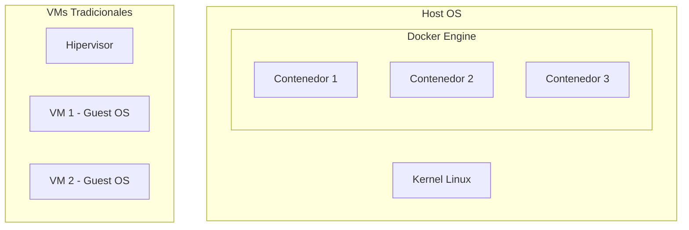
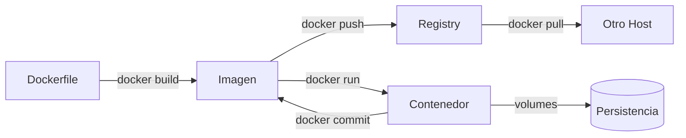

# Docker - Fundamentos y Conceptos

> **Objetivo**: Entender qué es Docker, cómo se diferencia de VMs, y los conceptos base para empezar.

---

## 1. Qué es Docker

**Docker** es una plataforma de **contenedores** que permite empaquetar una aplicación con todas sus dependencias (código, runtime, librerías, configuración) en una unidad estandarizada que se ejecuta de forma consistente en cualquier entorno.

### Contenedores vs Máquinas Virtuales

| Aspecto | Contenedores (Docker) | Máquinas Virtuales |
|---------|----------------------|-------------------|
| **Arquitectura** | Comparten kernel del host | Kernel propio por VM |
| **Tamaño** | MBs (ligeros) | GBs (pesados) |
| **Inicio** | Segundos | Minutos |
| **Aislamiento** | Nivel proceso (namespaces/cgroups) | Nivel hardware (hipervisor) |
| **Densidad** | Cientos por host | Pocas por host |
| **Portabilidad** | Imagen portable | Imagen de disco completa |



> **Concepto clave**: Docker usa **namespaces** (aislamiento de vista: PID, NET, MNT, UTS, IPC, USER) y **cgroups** (control de recursos: CPU, memoria, I/O) del kernel Linux.

---

## 2. Arquitectura de Docker

```
┌─────────────────────────────────────────────────────────────┐
│                        Docker Client (CLI)                   │
│                    docker build, run, push...                │
└─────────────────────────┬───────────────────────────────────┘
                          │ REST API (unix socket / TCP)
                          ▼
┌─────────────────────────────────────────────────────────────┐
│                      Docker Daemon (dockerd)                 │
│  ┌─────────────┐  ┌─────────────┐  ┌─────────────────────┐  │
│  │ Images      │  │ Containers  │  │ Networks / Volumes  │  │
│  └─────────────┘  └─────────────┘  └─────────────────────┘  │
└─────────────────────────┬───────────────────────────────────┘
                          │
                          ▼
              ┌───────────────────────┐
              │   Containerd / runc   │  (Runtime bajo nivel)
              └───────────────────────┘
```

### Componentes Principales

| Componente | Función |
|------------|---------|
| **Docker Client** | CLI (`docker`) que envía comandos al daemon |
| **Docker Daemon** (`dockerd`) | Gestiona imágenes, contenedores, redes, volúmenes |
| **Containerd** | Runtime de contenedores (gestión ciclo de vida) |
| **runc** | Implementación de referencia OCI (crea contenedores) |
| **Registry** | Almacén de imágenes (Docker Hub, GHCR, privado) |

---

## 3. Conceptos Fundamentales

### 3.1 Imagen (Image)
- Plantilla **inmutable** y **capas apiladas** (read-only)
- Construida desde un `Dockerfile`
- Identificada por `nombre:tag` (ej. `nginx:1.25-alpine`)
- `latest` = tag por defecto (⚠️ evitar en producción)

### 3.2 Contenedor (Container)
- Instancia **ejecutable** de una imagen
- Capa **escritura** (read-write) sobre la imagen
- Efímero: datos se pierden al eliminar (salvo volúmenes)
- Estados: `created` → `running` → `paused` → `stopped` → `removed`

### 3.3 Registro (Registry)
- Servidor que almacena y distribuye imágenes
- **Docker Hub**: público oficial (`docker.io`)
- **GHCR**: `ghcr.io/usuario/imagen`
- **Privado**: Harbor, Nexus, Artifactory, self-hosted

### 3.4 Capas (Layers) y Union FS
```
Imagen final (read-write layer - contenedor)
├── Capa 5: COPY app/ /app          ← Cambios frecuentes (último)
├── Capa 4: RUN pip install -r req  ← Dependencias
├── Capa 3: RUN apt-get update && apt-get install -y python3
├── Capa 2: RUN apt-get update
└── Capa 1: FROM python:3.11-slim   ← Base (primera)
```
- Cada instrucción `RUN`, `COPY`, `ADD` crea una capa
- **Caché**: Docker reutiliza capas sin cambios → builds rápidos
- **Orden importa**: Pon lo que cambia MÁS AL FINAL

---

## 4. Instalación

### 4.1 Linux (Recomendado: script oficial)

```bash
# Método oficial (siempre actualizado)
curl -fsSL https://get.docker.com | sh

# Verificar
docker version
docker run --rm hello-world
```

### 4.2 Gestión del Servicio (systemd)

```bash
# Iniciar y habilitar al arranque
sudo systemctl start docker
sudo systemctl enable docker

# Estado
sudo systemctl status docker

# Reiniciar tras cambios config
sudo systemctl restart docker
```

### 4.3 Usuario sin sudo (Grupo docker)

```bash
# Añadir usuario al grupo docker
sudo usermod -aG docker $USER

# Aplicar cambios (nueva sesión o)
newgrp docker

# Verificar
docker run --rm hello-world
```

> ⚠️ **Seguridad**: El grupo `docker` equivale a `root` (monta `/host`, accede a socket). Solo usuarios de confianza.

### 4.4 Configuración del Daemon (`/etc/docker/daemon.json`)

```json
{
  "log-driver": "json-file",
  "log-opts": {
    "max-size": "10m",
    "max-file": "3"
  },
  "storage-driver": "overlay2",
  "default-ulimits": {
    "nofile": { "Name": "nofile", "Hard": 64000, "Soft": 64000 }
  },
  "experimental": false,
  "features": { "buildkit": true }
}
```

---

## 5. Primeros Pasos Verificación

```bash
# Info del sistema
docker version
docker info

# Imagen de prueba
docker run --rm hello-world

# Contenedor interactivo
docker run -it --rm ubuntu:22.04 bash

# Verificar recursos
docker system df          # Uso disco
docker system events      # Eventos en tiempo real
```

---

## 6. Flujo de Trabajo Básico



---

## 7. Referencias Cruzadas

- [Dockerfile y Construcción](./Docker%20-%20Dockerfile%20y%20Construcci%C3%B3n%20de%20Im%C3%A1genes.md)
- [Gestión de Contenedores](./Docker%20-%20Gesti%C3%B3n%20de%20Contenedores.md)
- [Redes y Volúmenes](./Docker%20-%20Redes%20y%20Vol%C3%BAmenes.md)
- [Docker Compose](./Docker%20-%20Docker%20Compose.md)
- [Buenas Prácticas](./Docker%20-%20Buenas%20Pr%C3%A1cticas%20y%20Seguridad.md)

---

*Etiquetas: #docker #fundamentos #contenedores #imagenes #registry #kernel #namespaces #cgroups #instalacion*