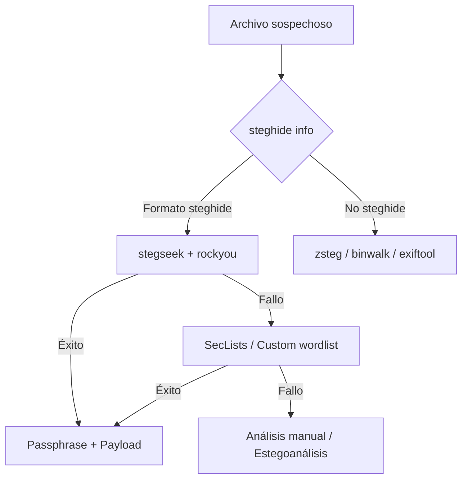

# Stegseek - Guía Rápida

> **Herramienta**: Fuerza bruta de passphrase para archivos **steghide** (Go, multi-plataforma, muy rápido).
> **Repositorio**: https://github.com/RickdeJager/stegseek

---

## Instalación

```bash
# Go (recomendado - versión más reciente)
go install github.com/RickdeJager/stegseek@latest
# ~/go/bin/stegseek

# O descargar binario release
wget https://github.com/RickdeJager/stegseek/releases/download/v0.6/stegseek_0.6_linux_amd64.tar.gz
tar -xzf stegseek_0.6_linux_amd64.tar.gz
sudo mv stegseek /usr/local/bin/

# Verificar
stegseek --version
```

---

## Uso Básico

```bash
# Sintaxis principal
stegseek [OPCIONES] <archivo_stego> <wordlist>

# Ataque diccionario simple
stegseek --crack imagen.jpg /usr/share/wordlists/rockyou.txt

# Extraer automáticamente al encontrar passphrase
stegseek --crack imagen.jpg rockyou.txt --extract

# Especificar archivo de salida
stegseek --crack imagen.jpg rockyou.txt --extract -o payload_extraido.bin
```

---

## Opciones Principales

| Flag | Descripción |
|------|-------------|
| `--crack` | Modo fuerza bruta (requerido) |
| `--extract` | Extraer payload automáticamente al éxito |
| `-o, --output` | Archivo salida extracción (default: `<stego>.out`) |
| `-t, --threads` | Hilos concurrentes (default: núcleos CPU) |
| `-v, --verbose` | Salida detallada |
| `-q, --quiet` | Solo mostrar passphrase encontrada |
| `--crack-all` | Continuar buscando tras primer hallazgo |
| `--benchmark` | Test velocidad (hashes/seg) |

---

## Wordlists Recomendadas

```bash
# 1. RockYou (clásica, 14M)
gunzip -c /usr/share/wordlists/rockyou.txt.gz > ~/wordlists/rockyou.txt

# 2. SecLists (Daniel Miessler)
git clone https://github.com/danielmiessler/SecLists.git ~/SecLists
# ~/SecLists/Passwords/Leaked-Databases/rockyou.txt.tar.gz
# ~/SecLists/Passwords/Common-Credentials/

# 3. Probables (top passwords)
# ~/SecLists/Passwords/Probable-Wordlists/

# 4. Custom para objetivo
cewl https://target.com -d 2 -m 6 -w target_words.txt
# Genera wordlist desde web scraping
```

---

## Ejemplos Prácticos

### Caso 1: CTF típico - JPEG con steghide
```bash
# 1. Confirmar que es steghide
steghide info challenge.jpg
# "steghide 0.5.1 - embedded data: 2048 bytes, encrypted: rijndael-256"

# 2. Ataque rápido con rockyou
stegseek --crack challenge.jpg ~/wordlists/rockyou.txt --extract

# 3. Si falla, probar SecLists
stegseek --crack challenge.jpg ~/SecLists/Passwords/Leaked-Databases/rockyou.txt --extract -t 8
```

### Caso 2: Passphrase con patrón conocido
```bash
# Wordlist personalizada con mutaciones
cat > custom.txt << 'EOF'
password
password123
Password123
admin123
secret
secret123
flag
ctf
stego
hidden
EOF

# Generar variaciones con hashcat rules
hashcat --stdout custom.txt -r /usr/share/hashcat/rules/best64.rule | sort -u > custom_mutated.txt

stegseek --crack challenge.jpg custom_mutated.txt --extract
```

### Caso 3: Benchmark y optimización
```bash
# Ver velocidad en tu CPU
stegseek --benchmark
# Ejemplo salida: "Benchmark: 1,245,678 passphrases/second"

# Ajustar hilos si sistema cargado
stegseek --crack challenge.jpg rockyou.txt -t 4  # 4 hilos
```

### Caso 4: Múltiples archivos (batch)
```bash
#!/bin/bash
# batch_stegseek.sh
for img in *.jpg *.jpeg *.bmp *.wav; do
    echo "[+] Probando: $img"
    stegseek --crack "$img" ~/wordlists/rockyou.txt --extract -q && \
    echo "    [!] ENCONTRADO en $img" && \
    file "${img}.out"
done
chmod +x batch_stegseek.sh
./batch_stegseek.sh
```

---

## Formatos Soportados (solo steghide)

| Formato | Extensión | Comentario |
|---------|-----------|------------|
| JPEG | .jpg, .jpeg | ✅ Principal |
| BMP | .bmp | ✅ |
| WAV | .wav | ✅ Audio PCM |
| AU | .au | ✅ Audio Sun/NeXT |

> **NO funciona**: PNG (steghide no soporta PNG), archivos no creados con steghide, LSB plano sin formato steghide.

---

## Flujo de Trabajo Recomendado



---

## Limitaciones y Troubleshooting

| Problema | Solución |
|----------|----------|
| "Not a steghide file" | No fue creado con steghide → usa zsteg, binwalk, strings |
| Muy lento | Aumenta `-t`, usa SSD, wordlist más pequeña |
| Memoria alta | Wordlist enorme → divide con `split -l 100000` |
| Passphrase con espacios/especiales | Wordlist debe tener comillas o escapes correctos |
| Archivo corrupto | `steghide info` falla → archivo dañado o no es steghide |

---

## Alternativas si stegseek falla

```bash
# 1. stegcracker (Python, más lento)
pip install stegcracker
stegcracker imagen.jpg rockyou.txt

# 2. John the Ripper (steghide format)
john --format=steghide --wordlist=rockyou.txt steghide_hash.txt
# Primero extraer hash: steghide2john imagen.jpg > hash.txt

# 3. Hashcat (mode 13400 = steghide)
hashcat -m 13400 -a 0 hash.txt rockyou.txt
```

---

## Checklist Rápido

- [ ] `steghide info archivo` confirma formato steghide
- [ ] Wordlist preparada (rockyou mínimo)
- [ ] `stegseek --crack archivo wordlist --extract`
- [ ] Si falla: wordlist mayor / mutaciones / reglas hashcat
- [ ] Verificar payload extraído (`file`, `strings`, `binwalk`)
- [ ] Documentar passphrase y herramienta exitosa

---

*Etiquetas: #stegseek #steghide #fuerza-bruta #passphrase #ctf #esteganografia*