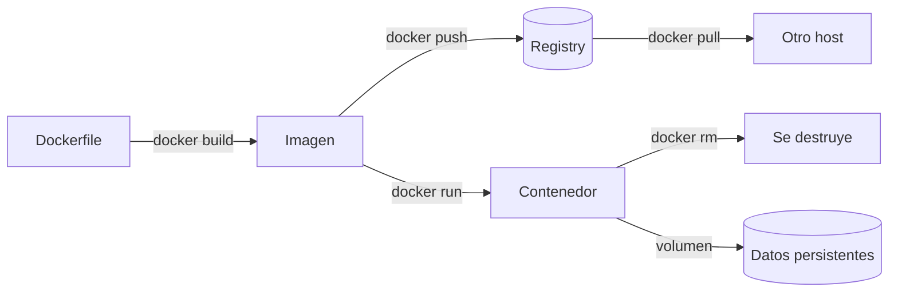

# Docker - Fundamentos y Conceptos

**Docker** es una plataforma de **contenedores**: empaquetar una aplicación con todo lo que necesita para ejecutarse (código, runtime, librerías, configuración) en una unidad estandarizada que corre igual en cualquier máquina. Pero la palabra "contenedor" esconde lo importante: **un contenedor no es una máquina virtual ni un chroot bonito — es un proceso normal del kernel Linux al que se le aplicaron mecanismos de aislamiento y límites de recursos**. Entender esos mecanismos (namespaces, cgroups, union filesystem) es la diferencia entre usar Docker y *entender* Docker; todo lo demás ([[Docker - Dockerfile y Construcción de Imágenes|Dockerfiles]], [[Docker - Redes y Volúmenes|redes]], [[Docker - Docker Compose|Compose]]) se apoya en este modelo mental.

> [!info] La definición operativa
> Si inspeccionás un contenedor desde el host (`ps aux`), ves **un proceso**: `runc` creó el proceso con flags de clone (`CLONE_NEWPID`, `CLONE_NEWNET`, …), lo metió en cgroups y le montó un rootfs aislado. No hay kernel extra, no hay hipervisor. Por eso un contenedor arranca en **milisegundos** y pesa **megas**: comparte el kernel del host.

## Qué es realmente un contenedor: las primitivas del kernel

Un contenedor moderno se construye combinando cuatro mecanismos que **ya existen en el kernel** desde hace años (namespaces llegaron en 2002–2008, cgroups en 2008). Docker no inventó el aislamiento: lo estandarizó, lo empaquetó y lo puso cómodo.

### 1. Namespaces — *qué ve* el proceso (aislamiento de vista)

Cada namespace aislada una dimensión del sistema. Un contenedor es un proceso al que se le asignaron varios namespaces a la vez:

| Namespace | Aísla | Efecto práctico en el contenedor |
|-----------|-------|----------------------------------|
| **PID** (`pid`) | Espacio de procesos | El proceso principal es el **PID 1**; no ve los procesos del host ni los de otros contenedores. `ps` dentro solo muestra lo propio |
| **Mount** (`mnt`) | Árbol de montaje | Cada contenedor tiene su propio `/`; ve su rootfs, no los discos ni mounts del host |
| **Network** (`net`) | Stack de red | Interfaces, tablas iptables, puertos y rutas propios. Puede tener su propia IP y stack completo |
| **UTS** | Hostname y dominio | `hostname` propio sin tocar el del host |
| **IPC** | Memoria compartida / colas SysV | `shm` aislado; dos contenedores no comparten segmentos de memoria compartida salvo que se indique |
| **User** (`user`) | Tabla UID/GID | Mapeo de UIDs: el "root" del contenedor (UID 0 interno) puede ser el UID 100000 en el host. Base del **rootless** y de user namespaces |
| **Cgroup** (`cgroup`) | Vista de límites | El proceso ve solo los límites de su propio cgroup (relevante con cgroups v2) |

```bash
# Prueba rápida del namespace PID (leé el "Anexo" al final):
docker run --rm --pid=host alpine ps aux   # ← ve TODOS los procesos del host: rompió el aislamiento PID a propósito
```

> [!tip] Un namespace = una vista, no una barrera de datos
> Los namespaces ocultan, no cifran. Un proceso que rompe su namespace (o nunca lo tuvo, ver tabla) accede a lo del host. Por eso el aislamiento real es **defensa en profundidad**: namespaces + capabilities + cgroups + seccomp + AppArmor. Ver [[Docker - Buenas Prácticas y Seguridad]] y el caso real de [[Abuso de Docker para Escalada de Privilegios y Escape de Contenedores]].

### 2. Cgroups v2 — *cuánto puede usar* el proceso (control de recursos)

Si los namespaces definen la vista, los **cgroups** (control groups) definen la **cuota**: CPU, memoria, I/O y número de procesos. Docker los aplica a todo el árbol de procesos del contenedor. Actualmente se usa **cgroups v2** (unificado; Docker 20.10+ lo soporta plenamente, en 2026 es el estándar en cualquier distro moderna):

| Recurso | Límite (cgroup v2) | Flag de `docker run` equivalente |
|---------|--------------------|-----------------------------------|
| CPU | `cpu.max` (cuota en µs por período) | `--cpus`, `--cpu-quota`/`--cpu-period` |
| CPU (peso relativo) | `cpu.weight` | `--cpu-shares` |
| Memoria | `memory.max`, `memory.high` | `--memory`, `--memory-reservation` |
| Memoria swap | `memory.swap.max` | `--memory-swap` |
| Procesos/threads | `pids.max` | `--pids-limit` (clave contra fork bombs) |
| I/O disco | `io.max` | `--device-read-bps` / `--device-write-bps` |

Sin cgroup, un contenedor "aislado" puede tumbar el host: una fork bomb o un `OOM` infinito. Con `--pids-limit` y `--memory` el kernel mata al abusador, no al host. Detalle completo en [[Docker - Gestión de Contenedores#Resource Constraints (cgroups)]].

### 3. Capabilities — el root ya no es root

Históricamente "root" (UID 0) podía todo. Linux parte ese superpoder en **capabilities** discretas (`CAP_NET_RAW`, `CAP_SYS_ADMIN`, `CAP_MKNOD`…). Docker **retira** al contenedor unas ~40 capabilities peligrosas por defecto y le deja solo las necesarias para arrancar:

| Capability | Qué permite | ¿La tiene el contenedor por defecto? |
|-----------|-------------|----------------------------------------|
| `CAP_CHOWN`, `CAP_SETUID`, `CAP_SETGID` | Cambiar ownership / UIDs | ✅ Sí |
| `CAP_NET_BIND_SERVICE` | Bindear puertos < 1024 | ✅ Sí |
| `CAP_NET_RAW` | Raw sockets (ping, ARP spoofing) | ✅ Sí |
| `CAP_SYS_ADMIN` | Montar, pivot_root, namespace, swapon… | ❌ **No** (la del escape clásico) |
| `CAP_SYS_MODULE` | Cargar módulos del kernel | ❌ No |
| `CAP_SYS_PTRACE` | Ptracear procesos | ❌ No |
| `CAP_DAC_OVERRIDE` | Ignorar permisos de archivo | ✅ Sí |

Por eso "el contenedor es root" **no** equivale a root del host… salvo que le devuelvan `SYS_ADMIN` (o corra `--privileged`, que devuelve *todas*). Es exactamente el vector que explota [[Abuso de Docker para Escalada de Privilegios y Escape de Contenedores]].

### 4. Union filesystem — el sistema de archivos de las imágenes

El cuarto pilar: el rootfs del contenedor no es un disco, es una **pila de capas (layers)** fusionadas en un único punto de vista mediante un *union filesystem* (el driver moderno es **overlay2**, y en hosts recientes el snapshotter de containerd `overlayfs`):

```
Vista del contenedor (lo que "ve" la app)      ← capa writable (copy-on-write)
    ▲
    ├── capa alta:  COPY src/ /app        (rw-creada al correr)
    ├── capa media: RUN apt-get install   (ro)
    ├── capa base:  FROM python:3.11-slim (ro)
    └── (whiteouts: archivos "borrados" = marcador .wh., no desaparecen de verdad)
```

- Cada instrucción de build (`RUN`, `COPY`, `ADD`) crea una capa **read-only**.
- El contenedor añade arriba una capa **read-write** efímera. Si dos contenedores salen de la misma imagen, **comparten las capas rojas** (por eso 100 contenedores de nginx no ocupan 100× nginx) y cada uno tiene su propia capa blanca.
- Escribir sobre un archivo de una capa roja dispara **copy-up**: el kernel copia el archivo completo a la capa writable y ahí se modifica. Por eso escribir archivos grandes contigo veces es lento — usá volúmenes (ver [[Docker - Redes y Volúmenes]]).
- `docker rmi` elimina la capa solo si ningún otro contenedor/imagen la referencia. `docker system df` muestra cuánto es recuperable.

> [!warning] El union filesystem NO es persistencia
> La capa writable muere con el contenedor (`docker rm` la borra para siempre). Cualquier dato que importe — bases de datos, uploads, logs— va a un **volumen**. Ver [[Docker - Redes y Volúmenes]].

## Contenedores vs Máquinas Virtuales — comparación profunda

| Aspecto | Contenedores (Docker) | Máquinas Virtuales |
|---------|----------------------|-------------------|
| **Qué se aísla** | Procesos (namespaces/cgroups sobre el kernel del host) | Máquina completa (hipervisor: KVM, Hyper-V) |
| **Kernel** | **Compartido** con el host | Propio por VM |
| **Inicio** | Milisegundos–segundos (es un `exec`) | Minutos (boot completo) |
| **Tamaño** | MBs (imagen base: 5–100 MB) | GBs (SO completo) |
| **Densidad** | Cientos por host | Pocas por host |
| **Overhead** | Prácticamente nulo (llamadas nativas al kernel) | Virtualización de hardware |
| **Portabilidad** | "Corre igual" **mientras el kernel sea Linux** | Cualquier SO como guest |
| **Aislamiento** | Débil de por sí; fuerte solo con todas las defensas | Fuerte (boundary de hipervisor) |
| **Arranque de imagen** | Segundos desde registry | Minutos desde ISO |

> [!info] La limitación que nadie te cuenta
> Los contenedores **no pueden correr un kernel distinto al del host**: no hay contenedores Windows sobre Linux nativos (ni viceversa). La imagen empaqueta *userland*, no kernel. Cuando necesitás otro kernel o aislamiento fuerte de verdad, querés una VM. Por eso los servicios de cloud suelen ser "VMs que corren un contenedor": mejor de ambos mundos.

## Imagen, contenedor y registro: el ciclo de vida

| Concepto | Qué es | Analogía exacta |
|----------|--------|-----------------|
| **Imagen** | Plantilla **inmutable** de capas read-only | Clase / plano de casa |
| **Contenedor** | Instancia **ejecutable** de una imagen (capa writable encima) | Objeto / casa construida |
| **Registry** | Servidor que almacena y distribuye imágenes (Docker Hub, GHCR, ECR…) | App Store / repositorio git |
| **Tag** | Etiqueta legible mutable (`nginx:1.27`, `miapp:latest`) | Rama de git (se mueve) |
| **Digest** | Hash inmutable `sha256:…` de contenido | Commit SHA de git |



- `latest` **no existe como garantía**: es un tag que cada autor puede mover. En producción se pinnea por versión exacta o, mejor, por **digest** (`image@sha256:…`). Ver por qué en [[Docker - Buenas Prácticas y Seguridad]].
- El flujo de build se detalla en [[Docker - Dockerfile y Construcción de Imágenes]]; el de ejecución, en [[Docker - Gestión de Contenedores]].

## Arquitectura de Docker: cliente, daemon, containerd, runc

Cuando ejecutás `docker run nginx`, la cadena es:

```
docker (CLI)  ──REST API (unix socket /var/run/docker.sock)──▶  dockerd (daemon)
                                                                  │
                                            ┌─────────────────────┴──────────────────────┐
                                            │  dockerd: imágenes, redes, volúmenes, API   │
                                            └─────────────────────┬──────────────────────┘
                                                                  ▼
                                                          containerd (runtime)
                                                                  │
                                                    ┌─────────────┴─────────────┐
                                                    ▼                           ▼
                                              runc (crea el proceso      shim (supervisa,
                                              con namespaces/cgroups)    maneja signals/logs)
```

| Componente | Función | Nota clave |
|------------|---------|-----------|
| **Cliente (`docker`)** | CLI que habla REST API | Cualquier cliente puede hablar con el daemon: no hay magia en el CLI |
| **dockerd** (`docker daemon`) | Daemon principal: imágenes, contenedores, redes, volúmenes, build | Vive en `/var/run/docker.sock` |
| **containerd** | Runtime de ciclo de vida: pull, snapshot, exec, log | Estándar de facto; lo usan Docker, K8s, Podman (cada uno a su manera) |
| **runc** | Implementación de referencia **OCI**: crea el proceso con namespaces+cgroups | Es quien ejecuta las primitivas de la sección anterior. Alternativas: crun, gVisor (`runsc`), Kata |
| **buildkit** | Backend de build moderno (Docker 23+ lo usa por defecto) | Paralelismo, caché incremental, secrets. Ver [[Docker - Dockerfile y Construcción de Imágenes]] |
| **Registry** | Almacén de imágenes | Protocolo HTTP v2; Docker Hub, GHCR, ECR, Harbor |

> [!warning] El socket es root
> `/var/run/docker.sock` equivale a **root en el host**: quien lo monta dentro de un contenedor puede montar `/` del host y tomarlo. Regla de seguridad absoluta: no montar el socket salvo en herramientas de *build/scan* de confianza, nunca en apps. Este es EL vector de [[Abuso de Docker para Escalada de Privilegios y Escape de Contenedores]].

### Docker Engine vs Podman / rootless

| | Docker Engine | Podman | Rootless Docker |
|--|---------------|--------|-----------------|
| Daemon | `dockerd` (root) | **Sin daemon** (cada contenedor = proceso usuario) | `dockerd-rootless` corriendo como usuario |
| Multi-usuario | Uno por host, compartido | Natural (contenedores por usuario) | Por usuario |
| Compatibilidad CLI | Referencia | Compat casi 1:1 (`docker`→`podman`) | Idéntica |
| systemd | Servicio root | Integración `podman generate systemd` | Servicio de usuario |
| Cuando usarlo | Estándar, ecosistema completo | Hosts donde el daemon root es políticamente imposible; CI | Reducir riesgo del socket root |

En 2026 cualquier distro moderna puede correr Docker/Podman **sin root**; si trabajás en un host compartido, empezá por ahí.

## Filosofía de contenedor (lo que separa buenos de malos despliegues)

1. **Un proceso (con su árbol de hijos) por contenedor.** No "una VM con supervisor". Si juntás nginx+php+mysql en un contenedor, perdés escalado independiente, logs individuales y healthchecks honestos. Podés correr un proceso que lance otros (como PostgreSQL hace con sus workers) — la regla es *un servicio*, no *un PID literal*.
2. **Inmutabilidad**: los contenedores no se parchean en producción. Bug ⇒ nueva imagen ⇒ nuevo contenedor. `docker exec apt-get install` es *snowball* — funciona hasta el día que necesitás replicar. (Y `docker commit` como "guardar cambios" es anti-patrón: ver [[Docker - Gestión de Contenedores#Commit — por qué es un anti-patrón]]).
3. **Configuración como variables/archivos, código en la imagen**: imagen = artefacto inmutable; entorno = variables de entorno y volúmenes (estilo 12-factor).
4. **Logs a stdout/stderr**, no a archivos: `docker logs` es la fuente de verdad; el runtime los rotacióna (json-file + `max-size`, ver [[Docker - Gestión de Contenedores]]).
5. **Efímeros por defecto**: todo estado durable sale a volúmenes (ver [[Docker - Redes y Volúmenes]]); así podés destruir y recrear contenedores sin miedo — base de CI/CD y de labs tipo [[Docker - Laboratorios y Vulhub]].

## Instalación y configuración del host

```bash
# Instalación oficial (detecta distro; siempre la última estable)
curl -fsSL https://get.docker.com | sh

# Estado del servicio
sudo systemctl enable --now docker
sudo systemctl status docker

# Usuario sin sudo (⚠️ ver advertencia)
sudo usermod -aG docker $USER
newgrp docker          # o cerrar y abrir sesión
```

> [!warning] El grupo `docker` = root
> Un miembro del grupo `docker` controla el daemon vía socket y puede montar el host completo en cualquier contenedor → **es root con otro nombre**. Solo usuarios de confianza.

Verificación (valores reales de este host, Docker 29.9.0 / cgroups v2):

```bash
docker version        # cliente + server; si falla el server, el daemon no corre
docker info           # storage driver (overlayfs/overlay2), cgroup v2, runtime (runc), logging (json-file)
docker run --rm hello-world
docker system df      # uso: imágenes, contenedores, volúmenes, build cache
```

Configuración del daemon `/etc/docker/daemon.json` (los valores que importan de verdad):

```json
{
  "log-driver": "json-file",
  "log-opts": { "max-size": "10m", "max-file": "3" },
  "storage-driver": "overlay2",
  "default-ulimits": { "nofile": { "Name": "nofile", "Hard": 64000, "Soft": 64000 } },
  "live-restore": true
}
```

- `live-restore` mantiene los contenedores vivos si el daemon se reinicia — crítico en producción.
- El log driver es el guardián del disco: sin `max-size`, el json-file crece hasta llenar el host. También se configura por contenedor ([[Docker - Gestión de Contenedores]]) o por servicio en Compose ([[Docker - Docker Compose]]).

## Registros de imágenes

| Registro | URL | Notas |
|----------|-----|-------|
| **Docker Hub** | `docker.io` (o `index.docker.io`) | Por defecto si no especificás host: `nginx` = `docker.io/library/nginx`. Imágenes oficiales (`library/`) y verificadas |
| **GHCR** | `ghcr.io` | GitHub Container Registry; gratis para públicas, integra con Actions |
| **ECR** | `<account>.dkr.ecr.<region>.amazonaws.com` | AWS; auth con `aws ecr get-login-password` |
| **ACR** | `<nombre>.azurecr.io` | Azure |
| **Harbor / Nexus / Artifactory** | self-hosted | Enterprise, air-gapped, proxy-cache |

```bash
# La forma corta resuelve hosts:
docker pull nginx                 # → docker.io/library/nginx:latest
docker pull ghcr.io/owner/app:1.2 # → GHCR explícito
docker pull registry.example.com:5000/app@sha256:abc...  # digest: inmutable
```

## Errores comunes (fundamentos)

1. **`Cannot connect to the Docker daemon`**: el daemon no corre o el CLI apunta a otro host/context. `systemctl status docker`, `docker context ls`, `docker context use default`.
2. **`permission denied while trying to connect to the Docker daemon socket`**: no sos miembro del grupo `docker` (o falta relogin). `sudo usermod -aG docker $USER` + nueva sesión. Recuerda: ese grupo es root.
3. **"Funciona en mi máquina" con imágenes "latest"**: `latest` cambió entre hosts. Pinneá versión/digest (ver [[Docker - Buenas Prácticas y Seguridad]]).
4. **Se llena el disco y `docker system df` dice que casi todo es recuperable**: son capas y build cache; `docker system prune -a --volumes` lo libera (con cuidado: borra lo no referenciado, ver [[Docker - Comandos de Referencia Rápida#Sistema y limpieza]]).
5. **Contenedor "corre" pero la app tarda en aceptar conexiones**: confundiste *proceso iniciado* con *servicio listo*. Healthchecks + `depends_on: condition: service_healthy` resuelven esto (ver [[Docker - Docker Compose]]).
6. **Esperar que un contenedor vea la hora/locale del host**: cada imagen trae su propio tzdata y UTC por defecto; montá `/etc/localtime` o definí `TZ`.

## Cheatsheet de fundamentos

| Pregunta | Respuesta corta |
|----------|-----------------|
| ¿Qué es un contenedor? | Proceso con namespaces (vista) + cgroups (recursos) + capabilities reducidas + rootfs union |
| ¿Qué aísla qué? | PID/MNT/NET/UTS/IPC/USER → namespaces; CPU/RAM/PIDs → cgroups |
| Imagen vs contenedor | Planta vs edificio; capas ro vs capa rw |
| ¿Dónde viven los datos? | Volúmenes (nunca la capa writable) |
| ¿Cuánto pesa un contenedor? | MBs: no incluye kernel ni SO |
| ¿Puede un contenedor correr Windows? | No: comparte el kernel del host |
| `latest` es seguro en prod? | No. Usar versión exacta o digest |
| ¿root en contenedor = root en host? | No, pero el socket de Docker sí da root; y `--privileged` o `SYS_ADMIN` + [[Abuso de Docker para Escalada de Privilegios y Escape de Contenedores]] |
| Storage driver estándar | overlay2 (o snapshotter overlayfs de containerd) |
| Runtime estándar | runc (OCI) |

## Relacionadas

- [[Docker - Dockerfile y Construcción de Imágenes]] — cómo se construyen las imágenes y su caché de capas
- [[Docker - Gestión de Contenedores]] — CLI completa del ciclo de vida, límites y monitorización
- [[Docker - Redes y Volúmenes]] — qué pasa cuando el contenedor necesita hablar o persistir
- [[Docker - Docker Compose]] — orquestación declarativa multi-contenedor
- [[Docker - Buenas Prácticas y Seguridad]] — endurecimiento real de imágenes y runtime
- [[Docker - Comandos de Referencia Rápida]] — cheatsheet CLI completa
- [[Docker - Laboratorios y Vulhub]] — práctica ofensiva en entornos aislados
- [[Abuso de Docker para Escalada de Privilegios y Escape de Contenedores]] — qué pasa cuando el aislamiento se rompe
- [[Comandos Básicos de Sistema y Red en Linux]] — base Linux que Docker da por sentada
