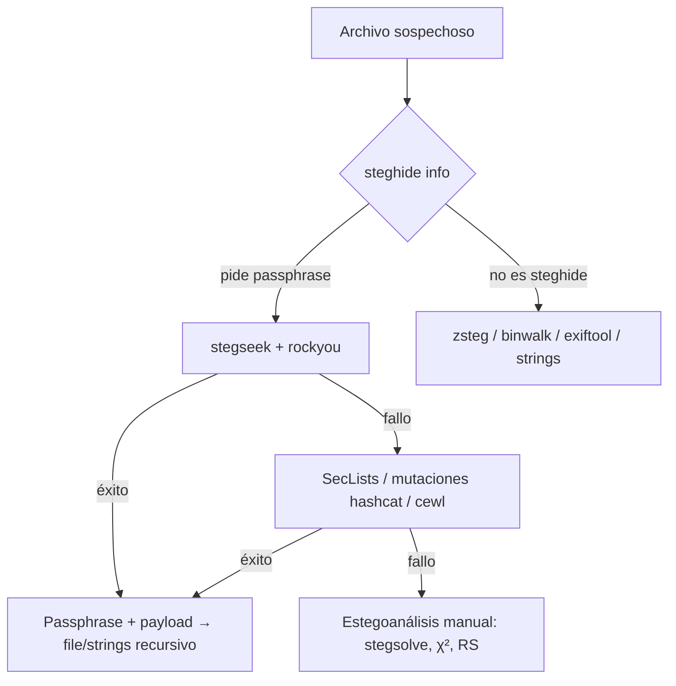

---
aliases:
  - Stegseek
  - Cracker de Steghide
  - Fuerza Bruta Steghide
tags:
  - sec/stego
tipo: concepto
estado: terminado
creado: 2026-10-11
actualizado: 2026-10-11
relacionado:
  - "[[Steghide - Uso Avanzado]]"
  - "[[Esteganografía - Conceptos, Herramientas y Práctica]]"
  - "[[Estegoanálisis - Detección y ContraMedidas]]"
  - "[[Zsteg - Análisis LSB PNG]]"
fuente: "https://github.com/RickdeJager/stegseek"
---

# Stegseek — Guía Rápida

**stegseek** es un cracker de passphrases para archivos creados con **steghide**, escrito en Go: prueba cada candidato de una wordlist contra el estándar de datos embebido a **más de un millón de intentos por segundo** en hardware moderno, y extrae el payload automáticamente al encontrar la clave. Es, con diferencia, la forma correcta de atacar steghide cuando la passphrase no se conoce.

> [!info] Por qué existe stegseek
> `steghide` **no tiene modo de fuerza bruta**: solo `extract` con una passphrase conocida. Antes de stegseek se usaban `stegcracker` (Python, lento), `steghide2john` + John the Ripper, o hashcat mode 13400. Stegseek reimplementó la verificación de la passphrase de steghide en Go con paralelismo por CPU: lo que a stegcracker le llevaba horas, stegseek lo resuelve en segundos.

## Instalación

```bash
# Go (versión más reciente)
go install github.com/RickdeJager/stegseek@latest      # → ~/go/bin/stegseek

# Binario release
wget https://github.com/RickdeJager/stegseek/releases/download/v0.6/stegseek_0.6_linux_amd64.tar.gz
tar -xzf stegseek_0.6_linux_amd64.tar.gz && sudo mv stegseek /usr/local/bin/

stegseek --version
```

## Tabla de flags

| Flag | Descripción |
|---|---|
| `--crack` | Modo de ataque (obligatorio): `<stego> <wordlist>` |
| `--extract` | Extraer el payload automáticamente al encontrar la passphrase |
| `-o, --output FILE` | Archivo de salida de la extracción (defecto: `<stego>.out`) |
| `-t, --threads N` | Número de hilos (defecto: núcleos de la CPU) |
| `-v, --verbose` | Salida detallada |
| `-q, --quiet` | Solo muestra la passphrase encontrada |
| `--crack-all` | Sigue buscando tras el primer hallazgo (passphrases múltiples) |
| `--benchmark` | Mide la velocidad (intentos/segundo) |

## Flujo de trabajo básico

```bash
# 0) Confirmar que el archivo es steghide (pide passphrase ⇒ hay datos)
steghide info challenge.jpg

# 1) Ataque con rockyou — el 90% de los CTF termina aquí
stegseek --crack challenge.jpg /usr/share/wordlists/rockyou.txt --extract

# Salida típica:
# [+] Found passphrase: "password123"
# [+] Extracting to "challenge.jpg.out"...

# 2) Inspeccionar el resultado (¡el payload suele ser otro contenedor!)
file challenge.jpg.out && cat challenge.jpg.out
strings -n 6 challenge.jpg.out | head
```



## Cuándo usar stegseek y cuándo no

| Situación | Herramienta | Motivo |
|---|---|---|
| Archivo **steghide** + passphrase desconocida | **stegseek** | Único camino rápido |
| Archivo steghide + passphrase conocida | `steghide extract -p` | No hay nada que crackear |
| Passphrase recordada con patrón (`empresa2024!`) | Wordlist pequeña + `stegseek` | Minutos → segundos |
| PNG/BMP sin steghide | **zsteg**, nunca stegseek | "Not a steghide file" |
| Passphrase de ≥ 12 caracteres aleatorios | **Imposible** (2^72+): buscar otra vía | Estegoanálisis, no cracking |
| Solo tienes CPU limitada o wordlist enorme | `stegseek -t N` o dividir wordlist | Controlar memoria/paralelismo |

> [!warning] El límite real es la entropía de la passphrase
> Stegseek rota rockyou (≈14 M) en segundos, pero **no es magia**: una passphrase aleatoria de 16+ caracteres no cae por diccionario. Si `stegseek` falla, la passphrase no está en tu wordlist — ampliar diccionario antes que aumentar hilos.

## Wordlists

```bash
# 1) Rockyou (clásica, 14 M contraseñas)
gunzip -c /usr/share/wordlists/rockyou.txt.gz > ~/wordlists/rockyou.txt

# 2) SecLists (Daniel Miessler)
git clone https://github.com/danielmiessler/SecLists.git ~/SecLists
#  ~/SecLists/Passwords/Leaked-Databases/rockyou.txt.tar.gz
#  ~/SecLists/Passwords/Common-Credentials/10k-most-common.txt
#  ~/SecLists/Passwords/Probable-Wordlists/

# 3) Wordlist dirigida al objetivo (OSINT del reto/organización)
cewl https://target.com -d 2 -m 6 -w target_words.txt

# 4) Mutaciones con reglas de hashcat
hashcat --stdout base.txt -r /usr/share/hashcat/rules/best64.rule | sort -u > mutadas.txt
```

## Ejemplos avanzados

### Passphrase con patrón conocido

```bash
cat > custom.txt << 'EOF'
password
password123
admin123
secret
flag
ctf
stego
hidden
EOF
hashcat --stdout custom.txt -r /usr/share/hashcat/rules/best64.rule | sort -u > custom_mutated.txt
stegseek --crack challenge.jpg custom_mutated.txt --extract
```

### Benchmark y optimización

```bash
stegseek --benchmark                 # p. ej. 1,245,678 passphrases/second
stegseek --crack challenge.jpg rockyou.txt -t 4      # limitar hilos (CPU ocupada)
```

### Lote sobre varios archivos

```bash
#!/bin/bash
# batch_stegseek.sh
for img in *.jpg *.jpeg *.bmp *.wav; do
    echo "[+] Probando: $img"
    if stegseek --crack "$img" ~/wordlists/rockyou.txt --extract -q; then
        echo "    [!] ENCONTRADO en $img"; file "${img}.out"
    fi
done
```

## Formatos soportados (exclusivamente steghide)

| Formato | Extensiones | Comentario |
|---|---|---|
| JPEG | `.jpg`, `.jpeg` | Formato principal |
| BMP | `.bmp` | Buena capacidad |
| WAV | `.wav` | Audio PCM |
| AU | `.au` | Audio Sun/NeXT |

**No funciona con**: PNG, GIF, MP3, TIFF, archivos LSB puros, o cualquier archivo no creado por steghide → mensaje `Not a steghide file`.

## Alternativas cuando stegseek no está disponible

```bash
# 1) stegcracker (Python — lento, mismos resultados)
pip install stegcracker
stegcracker imagen.jpg rockyou.txt

# 2) John the Ripper
steghide2john imagen.jpg > steghide_hash.txt
john --format=steghide --wordlist=rockyou.txt steghide_hash.txt

# 3) Hashcat (mode 13400 = steghide)
hashcat -m 13400 -a 0 steghide_hash.txt rockyou.txt
```

| Herramienta | Velocidad típica | Nota |
|---|---|---|
| **stegseek** | ~10⁶ intentos/s | Recomendada |
| hashcat (GPU) | ~10⁸/s si hay GPU | Requiere volcar el hash con `steghide2john` |
| John | ~10⁵–10⁶/s | Cómodo si ya usas John |
| stegcracker | ~10³/s | Solo como fallback |

## Cómo verifica stegseek la passphrase (mecánica)

Stegseek no "descifra a ciegas": reutiliza el mismo esquema de steghide y solo comprueba si la derivación es correcta:

1. Toma el candidato de la wordlist y ejecuta la **KDF de steghide** (basada en SHA-1) para derivar la clave de 256 bits.
2. Intenta **descifrar el estándar de datos embebido** (AES-256-CBC) con esa clave.
3. Comprueba el **checksum SHA-1** del payload resultante: si coincide → passphrase correcta.
4. Si hay passphrase, la imprime y (con `--extract`) repite el `extract` legítimo de steghide.

Consecuencias prácticas:

- No hay "medio acierto": o la KDF + checksum cierran, o el candidato se descarta. Por eso es seguro automatizarlo.
- El coste por candidato es constante ⇒ la velocidad depende solo de CPU/hilos (`--benchmark`).
- Un payload dañado (archivo truncado) puede dar falsos negativos: si `steghide info` es coherente pero nada cae, sospecha corrupción antes que passphrase mala.

| Escenario | Intentos típicos | Tiempo con stegseek |
|---|---|---|
| Top-100 / pista del reto | 10² | < 1 s |
| rockyou (14 M) | 1,4·10⁷ | 10–30 s (8 núcleos) |
| SecLists completo + reglas | 10⁸ | minutos |
| 6 dígitos puros (000000–999999) | 10⁶ | segundos (generar con `crunch`/`maskprocessor`) |
| Passphrase aleatoria ≥ 12 chars | ≥ 10¹⁴ | **inviiable**: cambiar de vía |

```bash
# Fuerza bruta de patrón conocido (no solo diccionario)
hashcat -a 3 --stdout -1 ?l?d '?1?1?1?1?1?1?1?1' > numeric8.txt   # 8 dígitos
stegseek --crack archivo.jpg numeric8.txt --extract
```

## Errores y troubleshooting

| Problema | Causa | Solución |
|---|---|---|
| `Not a steghide file` | No fue creado con steghide | [[Zsteg - Análisis LSB PNG]], `binwalk`, `strings` |
| No encuentra passphrase | No está en la wordlist | SecLists, cewl, reglas hashcat; si es aleatoria → rendirse |
| Lento / mucha RAM | Wordlist gigante | `split -l 100000 rockyou.txt -d` y atacar por partes |
| Passphrases con espacios | Wordlist mal escapada | Usar archivo, no `-p`; verificar comillas |
| `steghide info` falla | Archivo corrupto o no steghide | Reparar descarga, probar otras herramientas |
| Sin permisos de escritura | Salida en directorio protegido | `-o /tmp/out.bin` |

## Errores comunes del operador

1. **Ejecutar stegseek sobre PNG** por costumbre → siempre `steghide info` antes.
2. **No leer el `.out`**: el resultado es binario frecuentemente (`file`, `binwalk`, recursión).
3. **Ignorar la passphrase en la descripción del reto**: en CTF la pista suele estar en el enunciado; probar eso antes que rockyou.
4. **Dejar `.out` con el nombre original** y confundirlo con la cover (`-o` explícito evita la ambigüedad).
5. **No documentar la passphrase encontrada**: para el informe, registrarla (ver [[Esteganografía - Conceptos, Herramientas y Práctica]] §7).

## Cheatsheet

```bash
steghide info archivo.jpg                  # ¿es steghide?
stegseek --crack archivo.jpg ~/wordlists/rockyou.txt --extract
stegseek --crack archivo.jpg lista.txt --extract -o salida.bin -t 8
stegseek --benchmark
file archivo.jpg.out && strings archivo.jpg.out | head
# fallbacks:
stegcracker archivo.jpg rockyou.txt
hashcat -m 13400 -a 0 hash.txt rockyou.txt
```

**Checklist**: `steghide info` → rockyou → SecLists/cewl+reglas → fallbacks (stegcracker/john/hashcat) → `file`/`strings` recursivo → documentar passphrase y hash del original.

## Referencias

- Repositorio: <https://github.com/RickdeJager/stegseek>
- Releases: <https://github.com/RickdeJager/stegseek/releases>
- SecLists: <https://github.com/danielmiessler/SecLists>
- Hashcat (steghide mode 13400): <https://hashcat.net/wiki/doku.php?id=example_hashes>

## Relacionadas

- [[Steghide - Uso Avanzado]] — flags, capacidad y formato del objetivo
- [[Esteganografía - Conceptos, Herramientas y Práctica]] — flujo CTF completo
- [[Estegoanálisis - Detección y ContraMedidas]] — cuando el cracking falla
- [[Zsteg - Análisis LSB PNG]] — ruta alternativa para PNG/BMP
